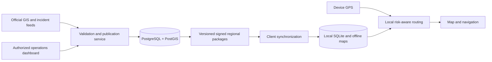

# Mobile implementation update

The native Expo client now implements the map, shelter review, route preview, foreground GPS guidance, rerouting, alternative shelters, arrival detection, SOS share sheet and training operations controls in EvacuationMapScreen.tsx. expo-sqlite persists the regional JSON graph locally. react-native-maps renders georeferenced overlays on the native basemap or in schematic mode. Optional authenticated publication/polling uses the training server. This supersedes earlier descriptions below that scoped working navigation to the browser. Native offline basemap downloads and background GPS remain unimplemented.

# System and implementation design

## Architecture

Implemented teaching path: browser GPS → training scenario centered on location → in-memory/localStorage graph → risk-aware Dijkstra → ranked shelter cards → route preview → GPS updates → closure-triggered replan. The same pure engine runs without the server. A Python HTTP service authenticates the local operations console and stores versioned JSON packages plus an audit log in SQLite. Online clients poll updates every ten seconds, applying packages only within 100 m of their active training origin. No real government data feed is connected.

Production target: React Native with a native offline-capable MapLibre renderer, foreground/background location service and SQLite repository; shared domain routing module; React operations dashboard; FastAPI services; PostgreSQL/PostGIS; signed regional packages in object storage; official incident adapters behind a validation and approval pipeline. Keep training identities and datasets in a separate tenant/environment. Never allow a training alert to enter the official public channel.

Production roadmap components above are a design, not delivered integrations. Current browser persistence uses localStorage plus Cache Storage; SQLite is on the local server. Native offline SQLite and PostGIS deployment remain future work.

## UI and flow

| View | Content and primary interaction |
|---|---|
| Home/map | Persistent training banner, GPS point, geographic basemap, distinct road/hazard/shelter symbols; FIND SAFE SHELTER |
| Shelter options | Ranked reachable shelters, walking distance/time, available spaces, status; review route |
| Shelter detail | Address, status, total/available capacity, medical, food, water, toilets, accessibility, demo contact; preview/start |
| Preview | Green route over road network and excluded hazard zones; off-network connector distance is reported |
| Navigation | Cardinal first-leg instruction, left/right/straight next-turn instruction, remaining graph distance and time; road-block controls |
| Reroute state | Live status announces route blockage, alternate route or shelter switch; no-path state stops guidance |
| Emergency | Coordinates and stored demo facility information; copy coordinates to clipboard |
| Offline | Package timestamp, connection badge, persistent schematic road map; explicit missing basemap coverage |
| Operations | Password login, shelter capacity/status, road status, hazard severity/activation, package and alert publication |

Navigation recomputes from the nearest graph node on GPS updates; this is basic demonstration guidance. Continuous map matching, voice guidance, destination arrival detection, heading smoothing and screen-reader map alternatives need production implementation. Large controls, keyboard focus, live status announcements and responsive layout are provided. Some operations use native browser prompts.

Flow: open → GPS/sample → training disaster package → analyze → ranked options → detail → preview/start → monitor → replan same shelter → otherwise switch reachable shelter → stop if no route.

## Routing and shelter selection

`web/engine.js` uses Dijkstra with non-negative weights. Each edge cost is `distance * (1 + risk * 8)`. Blocked roads and inaccessible roads (when requested) are excluded, as are edges whose segments intersect active hazard circles. All active hazards are treated as hard exclusion regardless of severity. Graph is bidirectional. Geographic distance is haversine; hazard intersection uses a local equirectangular projection suitable for the small demo area.

Filter shelters by OPEN, positive available capacity, accessibility and absence from active hazard circles. Compute a route to every remaining shelter; remove unreachable destinations; sort by risk-weighted cost. Return all candidates, including at least two when available. Walking ETA uses 75 m/min and is an estimate. No arbitrary straight-line route is substituted for a missing graph path. Off-network GPS snapping is not a verified traversable connector. Stop navigation outside 2 km from the loaded origin.

On closure: recompute the current destination; retain it if still reachable; otherwise choose the best remaining reachable shelter. If none remains, stop and show an explicit no-route state. New hazard/road/shelter packages trigger the same recomputation. Original server routing code is retained separately and not silently replaced by this engine.

## Working demo API

| Method/path | Input/auth | Response |
|---|---|---|
| GET /api/health | public, loopback | status/mode |
| POST /api/login | JSON password | one-hour in-memory bearer token; 401 if invalid |
| GET /api/package | public training data | latest revision and scenario data; zero/null before publication |
| PUT /api/package | bearer token + simulated scenario JSON | SQLite revision, 400 invalid body, 401 expired/missing token |

SQLite inserts package and audit in one transaction. Snapshots are immutable revisions. Local browser edits are staged locally until publication. Polling downloads the full latest snapshot, not a delta protocol. Admin token stays in memory; server restart invalidates it. Local-only password authentication is not enterprise RBAC. The default password is random per server launch.

Proposed production REST API: `POST /auth/session`; `GET /regions/{id}/manifest`; `GET /sync?region_id=&after_revision=`; `POST /routes` with position, travel profile and region revision; `GET/POST/PATCH /shelters`; `PATCH /roads/{id}`; `POST/PATCH /hazards`; `POST /events`; `POST /alerts`; `POST /observations`. Mutations require authorized role, audit actor, idempotency key and expected revision. Use 409 for revision conflicts, 422 for invalid geometries/capacities, and an explicit no-reachable-route response. Routes return ordered geometry, instructions, risk exclusions, dataset version, freshness and candidate alternatives.

## Production offline and synchronization design

Publish region manifests containing bounds, graph/schema version, timestamp, source provenance, map checksums and digital signature. Download to staging, verify, then atomically swap the SQLite package. Preserve the previous usable version on failure. Keep pending observations in an idempotent outbox; closures from authoritative sources take precedence over local reopening reports. Resynchronize on reconnect, then re-evaluate the route. Display freshness per source; stale/unknown risk must not be asserted as verified low risk.

Use self-hosted/offline-licensed raster or vector packages. Do not bulk-download public OSM tiles. Native MBTiles/PMTiles adapters, storage quota management and complete regional map packages are not implemented in the prototype. Service worker offline shell works on localhost or HTTPS; see https://developer.mozilla.org/en-US/docs/Web/API/Service_Worker_API .

## Map and GIS production path

Ingest a licensed OSM extract and official shelter registry. Preserve road geometry, intersection connectivity, directionality, bridges, elevation, surface, width and accessibility. Index WGS84 geometries in PostGIS. Intersect road geometries with validated hazard polygons and buffers when publishing packages; do not infer safety from road endpoints alone. Use spatial indexes to snap GPS with a bounded tolerance; reject origins without coverage. Keep actual facility data provenance separate from ML-derived risk proxies. Each disaster needs calibrated domain rules; changing an icon or label is not a physical flood/fire model.

## Production acceptance gaps

Before operational deployment: verified real road data and shelter registry; calibrated disaster-specific hazard inputs; native offline map/SQLite integration; enterprise identity/MFA/RBAC; TLS and rate limiting; signed package distribution and conflict resolution; emergency service agreements; localization and accessibility audit; field GPS/arrival/off-route testing; battery/performance/load testing; monitoring, backup/restore and incident operations. CRUD for adding new shelters/facilities and polygon drawing is designed but not implemented in the current console. No real SOS dispatch, live official alerts, voice navigation or claimed safety certification is provided.
